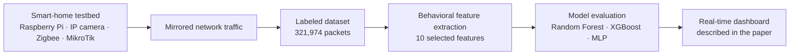

<div align="center">

# UoS-IoTBed-2026

### A testbed-driven benchmark for machine-learning intrusion detection in smart-home IoT networks

<p>
  
  
  
  
  
</p>

**Real traffic. Reproducible research. Practical IoT security.**

*Research project · University of Sharjah · 2026*

</div>

---

## At a glance

| **321,974** | **4** | **10** | **96.31%** |
|:---:|:---:|:---:|:---:|
| captured packets | traffic classes | selected behavioral features | best four-class accuracy* |

\* Random Forest result reported in the current paper draft; see [Research results](#research-results).

## The project

UoS-IoTBed-2026 is a labeled network-traffic dataset collected from a smart-home IoT testbed for evaluating machine-learning intrusion detection. The study examines normal traffic alongside denial-of-service (DoS) flooding, port scanning, and SSH brute-force activity.

The testbed combines a Raspberry Pi, an IP camera, Zigbee sensors, and a MikroTik router. The accompanying paper draft describes the capture and modeling methodology.

## From testbed to detection



## Research results

The figures below are reported in **Research Paper - IoT IDS draft 2**. They summarize the draft's experiments and have not been independently reproduced as part of this repository.

| Experiment | Result reported in draft |
|---|---:|
| Binary classification — Random Forest | **99.78% accuracy** |
| Binary classification — XGBoost | **99.73% accuracy** |
| Four-class classification — Random Forest | **96.31% ± 0.04** |
| Cross-dataset evaluation on testbed — CIC-IDS2017 | **74.80% accuracy** |
| Cross-dataset evaluation on testbed — Bot-IoT | **61.92% accuracy** |

The draft also describes a real-time dashboard for classifying mirrored traffic and generating alerts. **This repository contains the paper and CSV data; it does not include the dashboard implementation, model code, or trained model files.**

## Dataset contents

| Path | Contents |
|---|---|
| [`dataset/full/iot_ids_dataset.csv`](dataset/full/iot_ids_dataset.csv) | Combined dataset |
| [`dataset/normal/final_normal.csv`](dataset/normal/final_normal.csv) | Normal traffic |
| [`dataset/attacks/dos_final.csv`](dataset/attacks/dos_final.csv) | Denial-of-service traffic |
| [`dataset/attacks/portscan_final.csv`](dataset/attacks/portscan_final.csv) | Port-scanning traffic |
| [`dataset/attacks/bf_final.csv`](dataset/attacks/bf_final.csv) | Brute-force traffic |

## Data and privacy

The selected model features described in the paper exclude source and destination IP addresses and port numbers. **The CSV files themselves retain network metadata**, including packet timestamps, private-network IP addresses, and port information. This repository is private; review the data and access list before sharing it or changing repository visibility. The paper draft also contains author and university identifiers.

## Repository layout

```text
.
├── Research Paper - IoT IDS draft 2.docx
└── dataset
    ├── attacks
    │   ├── bf_final.csv
    │   ├── dos_final.csv
    │   └── portscan_final.csv
    ├── full
    │   └── iot_ids_dataset.csv
    └── normal
        └── final_normal.csv
```

## Paper

[Research Paper - IoT IDS draft 2.docx](Research%20Paper%20-%20IoT%20IDS%20draft%202.docx) — current manuscript draft describing the testbed, dataset, feature selection, and model evaluation.
